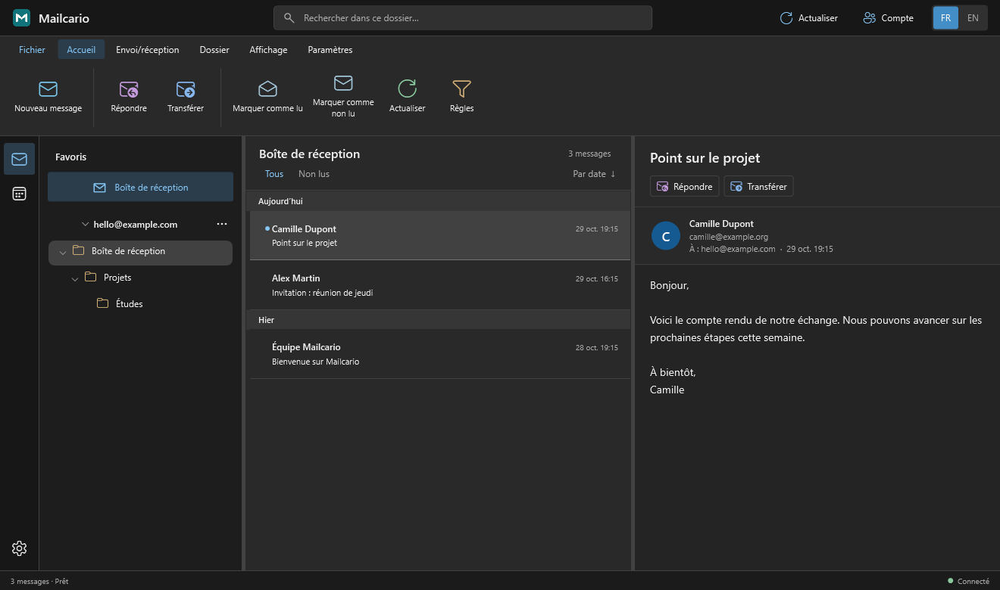
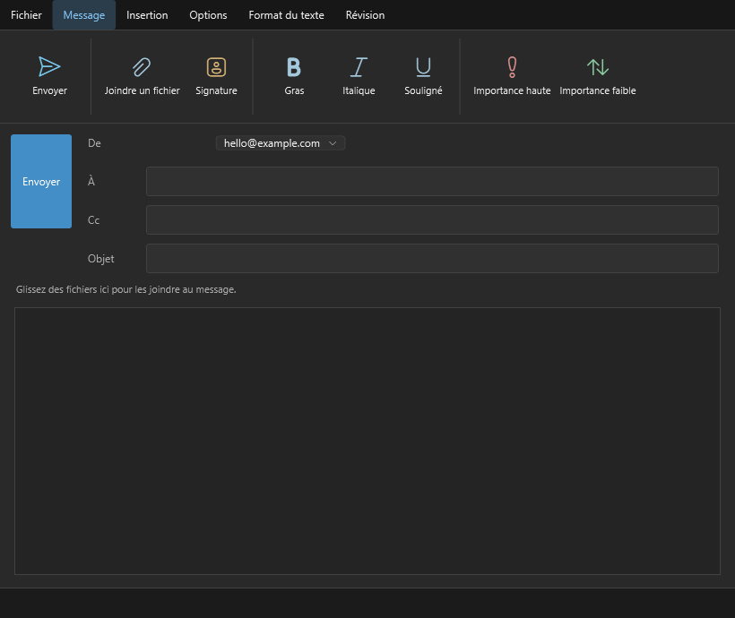
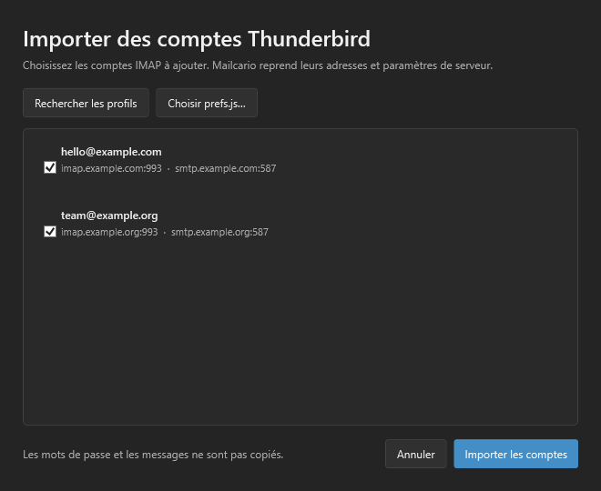
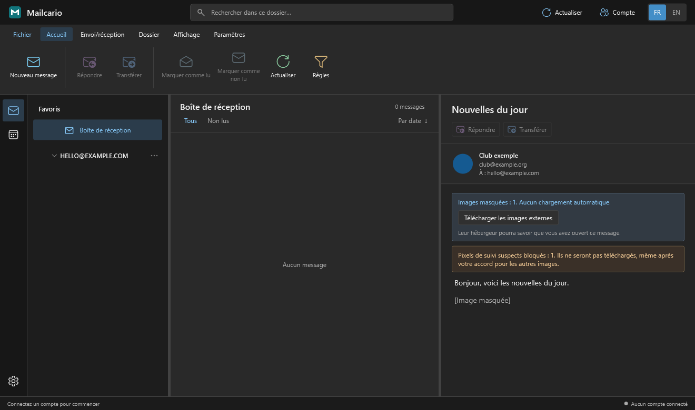
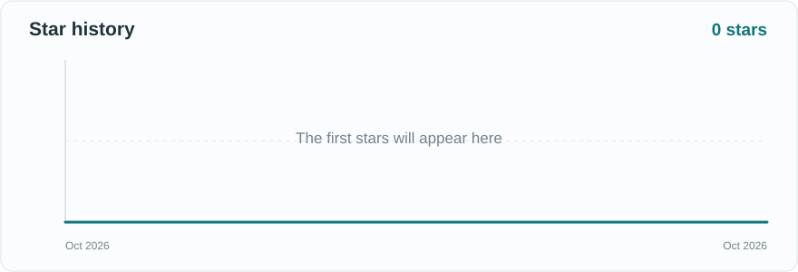

<p align="center">
  
</p>

<h3 align="center">Une boîte mail familière, à votre façon.</h3>

<p align="center">
  Un client de messagerie Windows gratuit et open source.<br>
  Plusieurs comptes, une interface inspirée d’Outlook, des invitations d’agenda et la confidentialité par défaut.
</p>

<p align="center">
  <a href="https://github.com/Bouneh/Mailcario/releases/latest"></a>
  <a href="LICENSE"></a>
  
  <a href="https://github.com/Bouneh/Mailcario/stargazers"></a>
</p>

<p align="center">
  <a href="https://github.com/Bouneh/Mailcario/releases/latest"><strong>Télécharger pour Windows</strong></a>
  &nbsp;·&nbsp; <a href="README.md">Read in English</a>
  &nbsp;·&nbsp; <a href="CONTRIBUTING.md">Contribuer</a>
</p>

<p align="center"></p>
<p align="center"><sub>Capture de démonstration avec des comptes et des messages fictifs.</sub></p>

## Votre messagerie sur Windows

| Une interface claire | Les fonctions du quotidien | La confidentialité intégrée |
| --- | --- | --- |
| Affichage en trois volets inspiré d’Outlook, colonnes redimensionnables, dossiers, recherche et thèmes clair et sombre. | Plusieurs comptes IMAP, envoi SMTP, réponses, transfert, pièces jointes, signatures, règles et notifications. | Images distantes bloquées par défaut, pixels de suivi détectés et bloqués, scripts HTML désactivés. |

Mailcario est un **client de messagerie local pour Windows**. Aucun serveur personnel n’est nécessaire : il utilise votre fournisseur de messagerie actuel. Les paramètres restent sur votre PC ; les identifiants enregistrés sont protégés pour votre compte Windows.

### Aperçu

| Rédaction | Import de comptes Thunderbird |
| --- | --- |
|  |  |

<details>
<summary><strong>Protection lors de la lecture</strong></summary>



Les images distantes ne sont pas téléchargées automatiquement. Un bandeau permet de charger les images ordinaires si vous le souhaitez ; les pixels de suivi détectés restent bloqués. Les images intégrées aux signatures peuvent aussi être affichées sur demande, sans contacter d’hébergeur externe.
</details>

## Commencer

1. Téléchargez `Mailcario-Setup-X.Y.Z.exe` depuis la [dernière version](https://github.com/Bouneh/Mailcario/releases/latest).
2. Lancez l’installateur. Mailcario s’installe pour votre compte Windows sans droits administrateur.
3. Ajoutez une adresse, ou utilisez **Fichier → Importer depuis Thunderbird** pour reprendre les comptes IMAP et leurs paramètres de serveur.
4. Connectez-vous auprès de votre fournisseur. Les mots de passe et les messages locaux de Thunderbird ne sont pas copiés.

Au démarrage, Mailcario cherche une version plus récente publiée sur GitHub. Vous pouvez choisir **Plus tard** ou **Télécharger la mise à jour**. Le téléchargement est vérifié avec son empreinte SHA-256, puis Mailcario s’installe et se rouvre automatiquement. Les nouvelles versions sont construites et publiées par GitHub Actions quand la version du projet augmente sur `main`.

Un nouveau mail apparaît dans une notification Windows avec un court extrait du message. Fermer la fenêtre laisse Mailcario actif dans la zone de notification ; son icône permet de rouvrir la boîte ou de quitter l’application.

### Fournisseurs

| Fournisseur | Connexion |
| --- | --- |
| La Poste | IMAP/SMTP avec les identifiants du compte |
| Gmail | Connexion Google dans le navigateur si l’application OAuth autorise votre compte ; sinon, mot de passe d’application. L’accès OAuth public dépend de la validation par Google. |
| iCloud | IMAP/SMTP avec un mot de passe spécifique à l’application |
| Autres fournisseurs | Paramètres IMAP/SMTP manuels |
| Outlook / Hotmail | La prise en charge OAuth existe, mais un identifiant d’application Microsoft doit être configuré pour se connecter |

Mailcario sait lire les invitations d’agenda reçues par e-mail et y répondre. L’agenda affiché est pour l’instant local ; la synchronisation complète avec Google ou Microsoft n’appartient pas à cette première version.

## Développé ouvertement

Mailcario est écrit en **C# / WPF avec .NET 10**. Le dépôt contient le client, l’installateur Inno Setup, l’assistant de mise à jour et un outil de prévisualisation qui génère des captures avec des données fictives.

```powershell
dotnet build Mailcario.csproj -c Release
dotnet run --project Preview/MailcarioPreview.csproj -c Release -- --thunderbird-import-check
```

Consultez [CONTRIBUTING.md](CONTRIBUTING.md) pour contribuer et [Installer/INSTALL_AND_UPDATES.md](Installer/INSTALL_AND_UPDATES.md) pour préparer une version.

## Historique des étoiles

[](https://star-history.com/#Bouneh/Mailcario&Date)

Le graphique est actualisé par GitHub Actions. [Explorer sur Star History](https://star-history.com/#Bouneh/Mailcario&Date).

## Licence

Mailcario est distribué sous [licence MIT](LICENSE). Les contributions sont les bienvenues.
