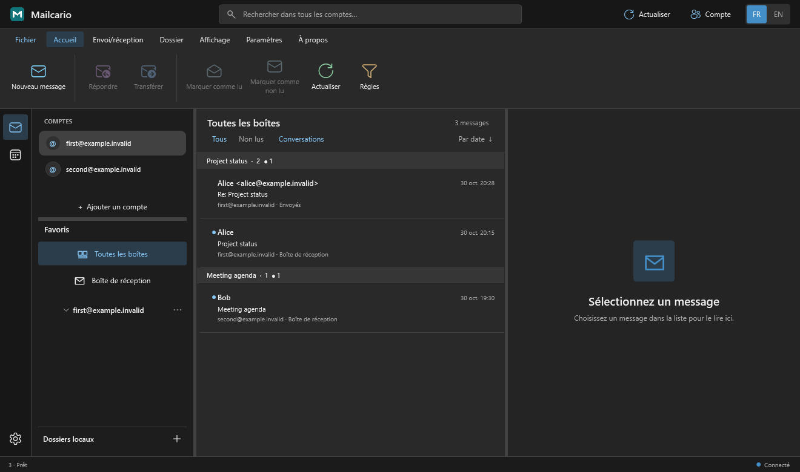

<p align="center">
  
</p>

<h3 align="center">A familiar inbox, on your terms.</h3>

<p align="center">
  A free, open-source desktop email client for Windows.<br>
  Multiple accounts, a focused Outlook-style layout, calendar invitations, and privacy by default.
</p>

<p align="center">
  <a href="https://github.com/Bouneh/Mailcario/releases/latest"></a>
  <a href="LICENSE"></a>
  
  <a href="https://github.com/Bouneh/Mailcario/stargazers"></a>
</p>

<p align="center">
  <a href="https://github.com/Bouneh/Mailcario/releases/latest"><strong>Download for Windows</strong></a>
  &nbsp;·&nbsp; <a href="README.fr.md">Lire en français</a>
  &nbsp;·&nbsp; <a href="CONTRIBUTING.md">Contribute</a>
</p>

<p align="center"></p>
<p align="center"><sub>Interface preview with fictional accounts and messages.</sub></p>

## Email that feels at home on Windows

| A clear workspace | Useful everyday tools | Privacy built in |
| --- | --- | --- |
| Outlook-inspired three-pane layout, resizable columns, folders, working folder search, light and dark themes. | Multiple IMAP accounts, SMTP sending, replies, forwarding, attachments, signatures from any account, a local address book, rules and notifications. | Remote images stay blocked until you allow them. Suspected tracking pixels remain blocked. HTML scripts are disabled. |

Mailcario is a **local Windows email client**. You do not need to host a server to read or send mail through your existing provider. Account settings stay on your PC; stored credentials are protected for your Windows user account.

Each folder loads recent messages first, then loads older messages as you scroll or select **Load older messages**. Search results also continue beyond the first page.

### All accounts, one view

Choose **All inboxes** in Favorites to read mail from every connected account together. The search field in that view searches all selectable server folders on every account, plus mail copied to local folders. Results keep their account and folder labels, and older server results load as you scroll. Turn on **Conversations** to group related received messages with your sent replies; each message retains its own read or unread state.



Right-click a message to assign a colored category, snooze it for an hour, until tomorrow, or for a week, or use a quick action such as **Mark read and archive**. Snoozed messages reappear while Mailcario is running when their time arrives. Keyboard shortcuts: `Ctrl+N` new message, `Ctrl+E` search, `Ctrl+R` reply, `Ctrl+Shift+R` reply all, `Ctrl+F` forward, `Ctrl+Q` mark read, `Ctrl+U` mark unread, and `Delete` move a selected message to Trash.

The compose ribbon includes **Templates** to save and reuse a subject and formatted body. After you click **Send**, the compose window closes and an **Undo** button appears in the main window's bottom-left status bar for 10 seconds by default. Undo cancels the queued send and reopens the draft. You can choose 0, 5, 10, 20, or 30 seconds in **Settings**. Once SMTP sending starts, the message cannot be recalled. **Options → Schedule send** stores the draft and a private copy of its attachments on this PC. Mailcario sends it when it is running at or after the chosen time. If the app or PC is off, sending waits until Mailcario starts again. **File → Scheduled messages** lets you review or cancel pending mail and manually retry an interrupted or failed send. Scheduled drafts, templates and categories are stored under `%LOCALAPPDATA%\Mailcario`; they are not synced to other devices.

Mailcario adds correspondents from messages it loads and from successful sends to the local address book. It also scans older mail headers in the background, folder by folder, to fill in existing correspondents without downloading message bodies or attachments. While composing, type a name or email address in **To**, **Cc**, or **Bcc** to see suggestions; use the arrow keys and Enter, or click a suggestion.

Right-click any mail folder to enable or disable notifications for that folder. A message moved by a Mailcario rule can alert you from its destination folder, and clicking the alert opens that folder. The general notification, sound and preview options remain in **Settings**.

### Local folders

Use **+** beside **Local folders** to create a folder on this PC. Select one or more server messages, then drag them onto a local folder or right-click and choose **Copy to local folder**. Mailcario saves the complete message, including attachments, for offline reading. The server originals stay in place until you delete them separately. You can rename or delete local folders with a right-click. Local copies are stored in `%LOCALAPPDATA%\Mailcario\LocalFolders` and are not synced to other devices; include this directory in your backups.

Received attachments are listed in the reading pane. You can download them, preview PDF, image and text files inside Mailcario, and print those previewable formats. Other file types can be saved and opened with a compatible application.

Choose **Source** in the reading pane or **View message source** in a message's context menu to inspect its original headers and MIME text. Search or copy the displayed source, or save the complete original message as an `.eml` file. Large messages show a 2 MB preview first, with **Show all** available on demand.

### A closer look

| Compose | Import Thunderbird accounts |
| --- | --- |
|  |  |

The compose ribbon includes clipboard tools, rich-text formatting, color palettes, numbered lists and recipient checking. You can drag files into a draft and switch between saved signatures. Unread inbox counts appear on the taskbar icon; opening a message updates the count.

<details>
<summary><strong>Message privacy controls</strong></summary>


Images from the internet are blocked by default. A message banner lets you load ordinary remote images when you choose; detected tracking pixels stay blocked. Signature images embedded in the email can also be shown on demand without contacting an external host. In **Settings**, you can enable automatic image loading separately for each account. Image hosts may then learn your IP address and when you opened a message; tracking detection is not infallible.
</details>

## Get started

1. Download `Mailcario-Setup-X.Y.Z.exe` from the [latest release](https://github.com/Bouneh/Mailcario/releases/latest).
2. Run the installer. Mailcario installs for your Windows account without administrator rights.
3. Add an address, or choose **File → Import from Thunderbird** to bring in IMAP account and server settings.
4. Sign in with your provider. Thunderbird passwords and local messages are not copied.

Mailcario checks for a newer published release when it starts. If one is available, you can choose **Later** or **Download update**. The download is checked against GitHub's SHA-256 digest before installation; Mailcario then restarts automatically. New releases are built and published by GitHub Actions when the project version increases on `main`.

Use **About** to see the installed version, open the repository, and check for or download an update at any time. Drag the divider beneath the account list to adjust its height.

New mail appears in a Windows notification with a short message preview. Closing the window keeps Mailcario running in the notification area; use its icon to reopen the inbox or quit the application.

### Provider support

| Provider | Connection |
| --- | --- |
| La Poste | IMAP/SMTP with your account credentials |
| Gmail | Google sign-in in your browser when the configured OAuth app permits your account; otherwise use an app password. Public OAuth access depends on Google's approval. |
| iCloud | IMAP/SMTP with an app-specific password |
| Other providers | Manual IMAP/SMTP settings |
| Outlook / Hotmail | OAuth support is implemented, but a Microsoft application client ID must be configured before sign-in works |

Mailcario can read calendar invitations attached to email and respond to them. Its calendar view is currently local; full calendar synchronization with Google or Microsoft is not part of this first release.

## Built in the open

Mailcario is written in **C# / WPF on .NET 10**. The repository contains the client, the Inno Setup installer, the update helper, and a preview tool that generates screenshots with fictional data.

```powershell
dotnet build Mailcario.csproj -c Release
dotnet run --project Preview/MailcarioPreview.csproj -c Release -- --thunderbird-import-check
```

See [CONTRIBUTING.md](CONTRIBUTING.md) for setup and development guidance, and [Installer/INSTALL_AND_UPDATES.md](Installer/INSTALL_AND_UPDATES.md) for release packaging.

## Star history

[](https://star-history.com/#Bouneh/Mailcario&Date)

The chart is refreshed from this repository's GitHub Actions workflow. [Explore it on Star History](https://star-history.com/#Bouneh/Mailcario&Date).

## License

Mailcario is released under the [MIT License](LICENSE). Contributions are welcome.
